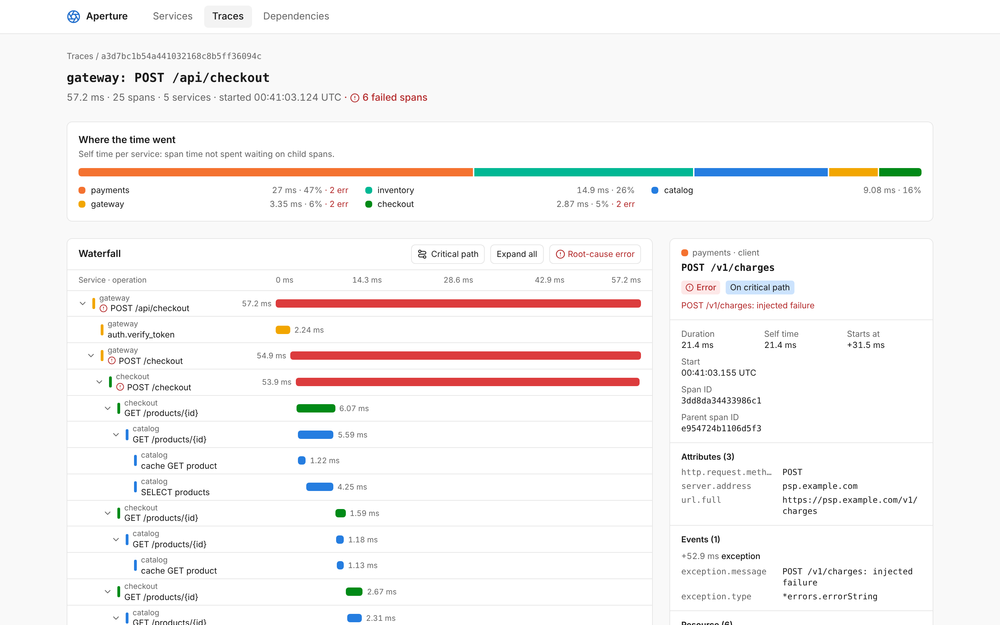
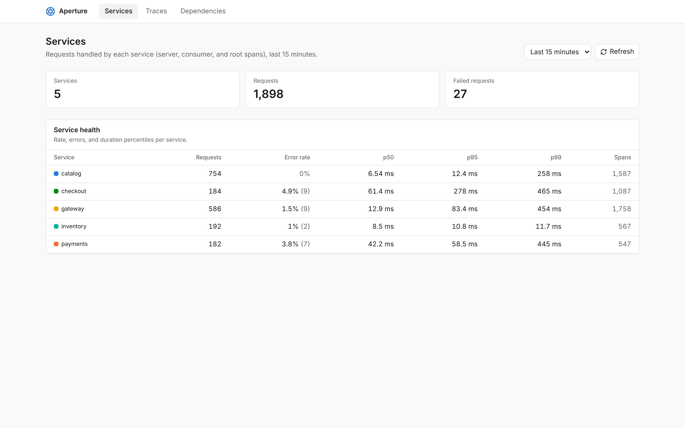
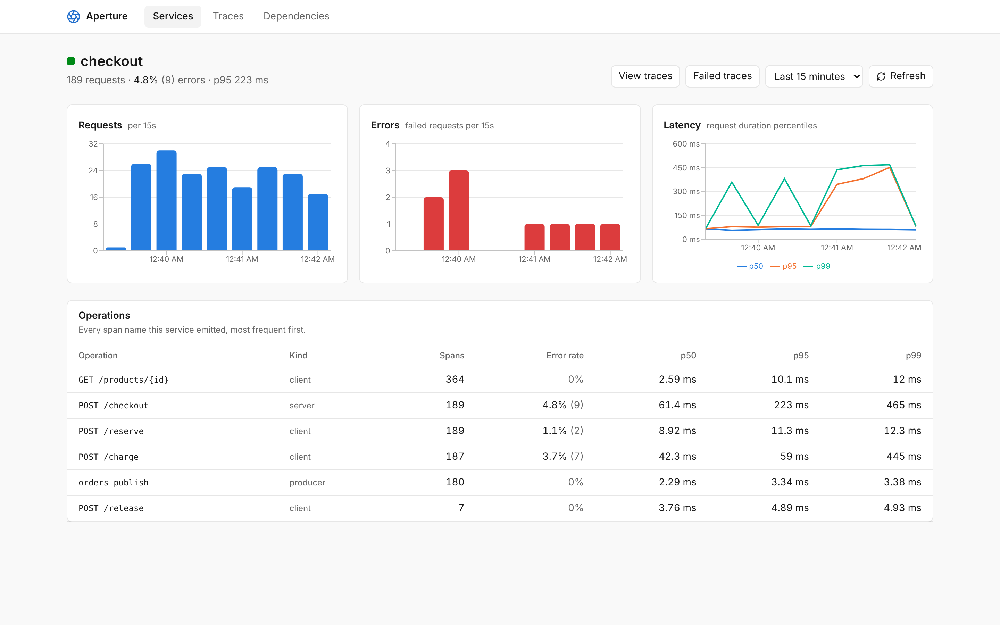
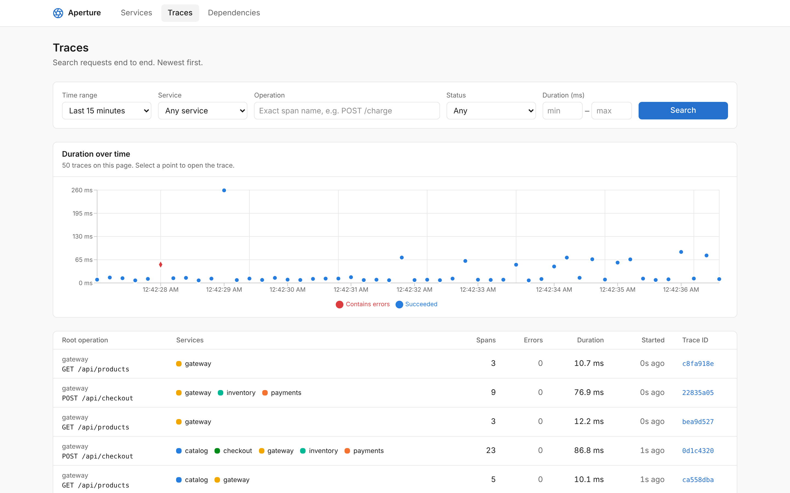
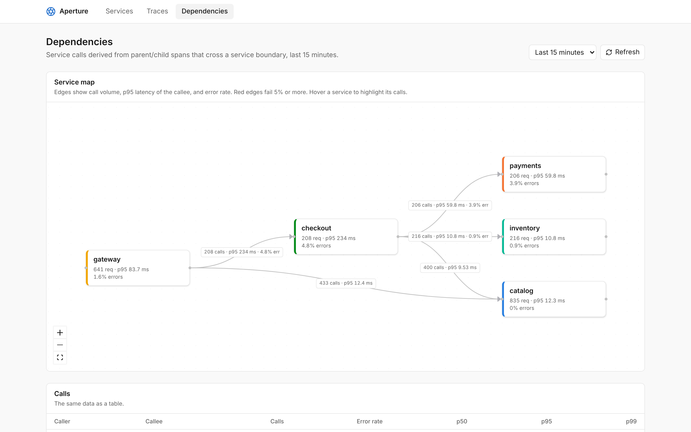

# Aperture

Aperture is a distributed tracing backend and UI. It ingests standard
OpenTelemetry traces over OTLP/HTTP and pushes them through a bounded,
batching pipeline. It acknowledges spans only after they are committed to
PostgreSQL, and serves a web UI for finding where requests got slow or failed
across microservices.



## Quick start

Requirements: Docker with Compose v2. Go 1.27+ is needed only for the trace
generator and benchmarks.

```sh
docker compose up -d --build --wait
```

This starts PostgreSQL, Aperture, an OpenTelemetry Collector, the web UI, and
a small instrumented shop: five Go services plus a traffic generator that
injects realistic latency and failures. Within a few seconds traces show up
at **http://localhost:3000**.

| URL | What |
|---|---|
| http://localhost:3000 | Web UI: services, traces, trace waterfall, dependency graph |
| http://localhost:8080/v1/traces | OTLP/HTTP protobuf ingestion (direct) |
| localhost:4317 / localhost:4318 | Collector OTLP gRPC / HTTP (point your own apps here) |
| http://localhost:8080/api/v1/… | JSON query API |
| http://localhost:8080/metrics | Prometheus metrics; `/healthz`, `/readyz` probes |

To send synthetic traces as well: `go run ./cmd/tracegen -traces 100`.
To make the demo misbehave, see [docs/demo.md](docs/demo.md).

## What you can do in the UI

| | |
|---|---|
|  | **Services:** request rate, error rate and p50/p95/p99 for every service, computed from entry spans only. |
|  | **Service detail:** RED time series and per-operation stats. |
|  | **Trace search:** filter by service, operation, errors and duration; scatter plot of duration over time; keyset pagination. |
|  | **Dependency graph:** service-to-service calls with volume, error rate and p95 per edge. |

The trace view shows a collapsible waterfall, the critical path, and self time
per service. One click jumps to the deepest failed span (the likely root
cause). Every view has a dark mode, keyboard navigation and visible focus,
and errors are never signalled by color alone.

## Design highlights

* **Standards-based ingestion.** Official OTLP protobuf types, gzip, and the
  OTLP/HTTP status-code and partial-success semantics. Malformed spans are
  rejected individually and reported; valid spans in the same request are
  kept.
* **Explicit durability.** A `200` means the spans are in a committed
  PostgreSQL transaction. Retries are idempotent through a
  `(trace_id, span_id)` primary key. See [docs/ingestion.md](docs/ingestion.md).
* **Bounded, batched pipeline.** A fixed-size queue sheds load with `503` +
  `Retry-After` instead of growing memory; workers coalesce requests into
  single-statement `unnest` inserts.
* **Measured.** Reproducible load tests with a durability check after every
  run, and a profile-guided optimization reported with both its
  microbenchmark win and its end-to-end effect. See
  [docs/benchmarks.md](docs/benchmarks.md).
* **Operable.** Liveness/readiness probes, Prometheus metrics for every stage,
  structured JSON logs, graceful shutdown that drains in-flight work.

## Development

```sh
make up            # start the stack
make test          # Go suite incl. PostgreSQL integration and end-to-end tests
cd web && npm test && npx playwright test   # UI unit and browser tests (stack running)
make bench         # ingestion benchmarks (stop the stack first)
make down
```

Integration tests create and drop their own databases on the server named by
`APERTURE_TEST_DATABASE_URL`; without it they are skipped.

## Documentation

* [Architecture and design decisions](docs/architecture.md)
* [Ingestion, durability, and status codes](docs/ingestion.md)
* [Configuration](docs/configuration.md)
* [Demo shop and fault injection](docs/demo.md)
* [Benchmarks and profiling](docs/benchmarks.md)
* [Pinned versions](VERSIONS.md)

## Local-demo limitations

The Compose stack uses fixed local credentials, plain HTTP, and no
authentication on ingestion or metrics. Ports bind to `127.0.0.1` only. Do not
expose it to a network as-is.
