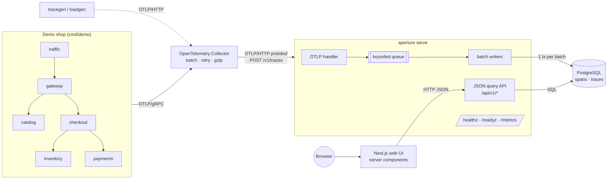
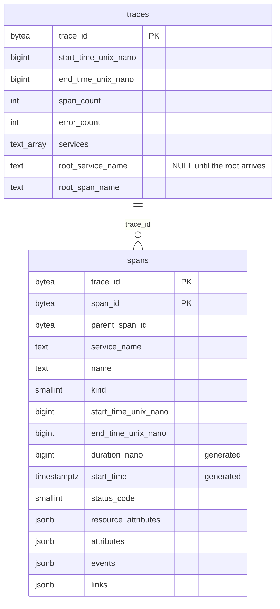

# Architecture

Aperture is a single-binary tracing backend with a separate web UI. This page
covers how the pieces fit together, and why each decision was made the way it
was. [ingestion.md](ingestion.md) covers the write path in detail.

## System overview

| Component | Code | Responsibility |
|---|---|---|
| OTLP handler | `internal/otlpingest` | Decode protobuf (and gzip), validate each span, convert to `model.Span`, map pipeline results to OTLP status codes |
| Pipeline | `internal/pipeline` | Bounded queue, batching workers, ack-after-commit, overload shedding, drain on shutdown |
| Store | `internal/store/postgres` | Migrations (goose, embedded), batched `unnest` insert plus trace-summary upsert, read queries |
| Query API | `internal/api` | Trace search with keyset pagination, trace detail, services, operations, RED time series, dependency graph |
| Server and app | `internal/server`, `internal/app`, `cmd/aperture` | HTTP mux, probes, metrics, config from env, graceful shutdown order |
| Web UI | `web/` | Service overview, service detail, trace search, trace waterfall, dependency graph |
| Demo shop | `cmd/demo` | Five instrumented Go services plus a traffic generator, with runtime fault injection |
| Load tools | `cmd/tracegen`, `cmd/loadgen`, `cmd/benchreport`, `bench/run.sh` | Synthetic traces, benchmark driver, durability verification, reports |

## Data model

- **`spans`** holds one row per span. The columns that queries filter or group
  on are real columns. Attributes, events and links are JSONB, because their
  shape is open-ended and they are only read when a single trace is opened.
- **`traces`** is a per-trace summary that the same statement maintains in the
  same transaction as the span insert. Spans of one trace arrive out of order
  and across many requests. The upsert widens the time range, adds counts only
  for *newly inserted* spans (so retried requests don't double-count), merges
  the service set, and fills in the root span once it arrives. Trace search
  reads this table, so it never aggregates millions of spans per query.
- Lock order is deterministic: both inserts are sorted by key, so concurrent
  workers that touch the same traces don't deadlock.

## Read path

- **Trace search** reads `traces`. It filters by time window, service (GIN
  index on `services`), errors (partial index), and duration. It pages with a
  keyset cursor on `(start_time, trace_id)`, so page 100 costs the same as
  page 1. An operation filter adds an `EXISTS` subquery on `spans`.
- **Service RED metrics** (rate, errors, duration percentiles) are computed
  from *entry spans*: SERVER or CONSUMER spans, or roots. Counting every
  internal and client span would inflate the request rate. Time series use
  `date_bin`, and percentiles use `percentile_cont`.
- **The dependency graph** is a parent/child self-join on
  `(trace_id, parent_span_id)`. It keeps edges where the service changes and
  aggregates call count, errors and p95 per edge.
- **The UI** is Next.js App Router with server components. Pages fetch from
  the API on the server (`web/lib/api.ts` is server-only), so the browser
  never talks to Aperture directly and every page has a shareable URL
  carrying its filters. Charts and the graph are client components that
  receive plain data.

## Decisions and tradeoffs

### PostgreSQL as the only datastore

**Chosen:** one PostgreSQL database for spans, summaries and queries.

**Why:**

- It is enough for the scale a single node targets. The
  [benchmarks](benchmarks.md) commit 20k spans/s on a shared 4-vCPU box, and
  up to 47k/s with larger requests.
- It gives real transactions, which the durability contract depends on.
- It is the system most developers can already operate.

**Cost:**

- Row storage is far larger per span than a columnar store such as ClickHouse.
- Analytical queries over long windows get slower as the table grows.
- There is no retention job yet, so tables grow until pruned.

**At larger scale:** partition `spans` by day (dropping partitions makes
retention cheap) before reaching for a different store.

### No Kafka, no Redis

The OTel Collector already provides a retrying, batching, buffering hop in
front of Aperture. Adding a broker would add a second durability boundary and
an operational dependency without a measured need. Redis was considered for
caching service lists and RED stats, but those queries are not the bottleneck
in any run so far, so it isn't used.

### Acknowledge after commit

A `200` is sent only after the span rows are committed. The alternative is
acknowledging on enqueue, which gives lower latency but loses acknowledged
data on a crash. It was rejected because the OTLP sender (the Collector)
already retries and queues, so the honest answer is cheap.

The cost shows up as latency. Every request waits for a batch commit,
including the flush interval. [benchmarks.md](benchmarks.md) quantifies the
dial. Duplicates from retries are absorbed by the `(trace_id, span_id)`
primary key, so delivery is at-least-once and storage is effectively once.

### Bounded queue that fails fast

When the queue is full, Aperture answers `503 Retry-After` immediately, rather
than blocking the request or growing an unbounded buffer. Memory stays flat
under overload, and back-pressure goes to the sender, which is built to
handle it. The overload benchmark shows rejects return in about 4 ms while
committed throughput holds steady.

### Per-span validation with partial success

One malformed span (a bad ID, an impossible timestamp, an oversized
attribute) doesn't sink the other spans in its request. They are stored, and
the response reports the rejected count and reasons through OTLP
`partial_success`. Limits on every dimension (attributes, events, name
length, nesting depth, decompressed size) bound the work a single request can
cause.

### Single statement `unnest` inserts

The insert sends arrays and unnests them in one statement. The alternatives
were COPY into a temp table and multi-row `VALUES`:

- it is one round trip per batch;
- it doesn't hit the 65,535 bind-parameter limit;
- it composes with `ON CONFLICT` and the CTE that maintains `traces`, which
  COPY can't do directly.

### No sampling, no tail-based logic

Aperture stores what it receives. Sampling belongs in the SDK or the
Collector (the `tail_sampling` processor), where it is already configurable.

### Profile before optimizing

The one CPU optimization so far, streaming JSON in the converter, came from
a pprof profile taken under load. It is reported with both its microbenchmark
win (3.6× faster) and its lack of end-to-end effect on the test machine. See
[benchmarks.md](benchmarks.md#profile-guided-optimization-streaming-json-in-the-converter).

## Failure modes

| Failure | Behaviour |
|---|---|
| PostgreSQL down at startup | `serve` exits with an error after one connection attempt; the supervisor (`restart: unless-stopped` in Compose, a Kubernetes restart) brings it back |
| PostgreSQL down while running | Batches fail and each request gets `503 Retry-After`; `/readyz` turns unready; the Collector retries |
| One bad row fails a batch | The worker retries each request of the batch on its own; only the offending request fails (`400` if the data is the problem) |
| Queue full | Immediate `503 Retry-After`; nothing is buffered beyond `APERTURE_QUEUE_CAPACITY` |
| Client disconnects mid-wait | The write still completes (it may already be in a batch); a retry deduplicates |
| SIGTERM | Stops accepting, drains queued work through the writers, then closes the pool, all within `APERTURE_SHUTDOWN_TIMEOUT` |

## What a production deployment would add

- authentication on ingestion and the API, and TLS;
- time-partitioned `spans` with a retention policy;
- several Aperture replicas behind a load balancer (the design is stateless
  apart from in-flight batches, which are never acknowledged before commit);
- a read replica for the query API.
