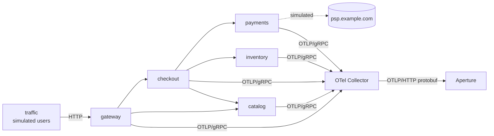

# Demo shop

`docker compose up` starts a small instrumented online shop next to Aperture,
so there is real, continuously generated trace data to explore.



All services are one Go binary (`cmd/demo`) started with different roles.
They use the OpenTelemetry Go SDK with `otelhttp`, so W3C `traceparent`
headers propagate across real HTTP calls between containers. Database,
cache, and payment-provider calls are simulated with client spans and
sleeps; nothing external is contacted.

| Service | Endpoints | Notable behaviour |
|---|---|---|
| gateway (`localhost:9000`) | `GET /api/products`, `POST /api/checkout` | auth span, proxies to catalog/checkout |
| catalog | `GET /products`, `GET /products/{id}` | 80% cache hits; 3% of DB calls spike by 250 ms |
| checkout | `POST /checkout` | sequential price lookups (an N+1 pattern), reserve, charge, compensating release on payment failure, `orders publish` producer span |
| inventory | `POST /reserve`, `POST /release` | 1% DB errors, 409 when out of stock |
| payments | `POST /charge` | 5% provider errors, 5% latency spikes of 400 ms |
| traffic | none | ~5 requests/s, 70% browse, 30% checkout |

## Injecting faults

Every service except `traffic` accepts runtime fault changes:

```sh
# make payments fail 40% of the time and add 150 ms to every call
docker compose exec gateway wget -qO- --post-data \
  '{"errorRate":0.4,"latencyMs":150,"slowRate":0,"slowLatency":0}' \
  --header 'Content-Type: application/json' http://payments:8080/admin/faults
```

Start-up defaults come from `FAULT_ERROR_RATE`, `FAULT_LATENCY_MS`,
`FAULT_SLOW_RATE`, and `FAULT_SLOW_MS` in `compose.yaml`. The traffic rate is
`TRAFFIC_RPS`.
