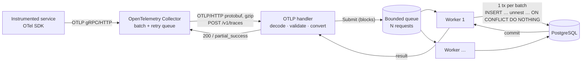

# Ingestion: protocol, pipeline, and durability

This document describes exactly what happens to a span between an OTLP client
and PostgreSQL, and what each response from Aperture promises.

## Path of a span

1. **Decode.** `POST /v1/traces` with `Content-Type: application/x-protobuf`
   (optionally `Content-Encoding: gzip`). The body is decoded with the official
   `go.opentelemetry.io/proto/otlp` types. Both the wire size and the
   decompressed size are capped, so a small gzip body cannot inflate without
   bound.
2. **Validate and convert.** Each span is checked independently (see below).
   Valid spans become `model.Span`; invalid ones are counted by reason.
3. **Submit.** Valid spans from one request form one *job*. The job is offered
   to a bounded channel without blocking. If the channel is full the request
   fails immediately with `503` and `Retry-After`.
4. **Batch.** Each worker takes a job, then keeps pulling jobs until the batch
   reaches `APERTURE_BATCH_SIZE` spans or `APERTURE_FLUSH_INTERVAL` passes.
5. **Write.** The batch is inserted in a single transaction with one
   statement (`INSERT … SELECT FROM unnest($1::bytea[], …)`). That costs one
   round trip per batch and avoids PostgreSQL's 65,535 bind-parameter limit.
6. **Acknowledge.** After `COMMIT` returns, every job in the batch is
   signalled and its HTTP handler answers `200`.

## Durability contract

> Aperture answers `200 OK` only after the spans in that request are part of a
> committed PostgreSQL transaction.

* The persistence boundary is **PostgreSQL commit**. With the default
  `synchronous_commit = on`, that means the WAL record is flushed to the
  database server's disk. Replication and backups are out of scope for the
  local demo.
* The in-process queue is **not** durable. A crash loses queued spans, but
  none of them were acknowledged, so a retrying client (the Collector's
  `retry_on_failure` + `sending_queue`) re-sends them.
* If the commit is not confirmed within `APERTURE_ACK_TIMEOUT`, or the client
  disconnects, the client sees a failure even though the spans may later
  commit. The retry is harmless: `(trace_id, span_id)` is the primary key and
  the insert uses `ON CONFLICT DO NOTHING`. Delivery is **at-least-once with
  idempotent storage**, so the stored result is effectively exactly-once per
  span ID.
* A failed multi-request batch is retried request by request, so one bad or
  unlucky request cannot fail its neighbours.

## Validation

A span is rejected (never truncated or rewritten) when:

| Reason | Condition |
|---|---|
| `invalid_trace_id` | not 16 bytes, or all zeros |
| `invalid_span_id` | not 8 bytes, or all zeros |
| `invalid_parent_span_id` | parent not empty/8 bytes, parent equals own ID, or a link has malformed IDs |
| `invalid_timestamp` | start or end is 0; end < start; end beyond int64; end more than `APERTURE_MAX_FUTURE_SKEW` in the future; duration over `APERTURE_MAX_SPAN_DURATION` |
| `invalid_kind` / `invalid_status` | enum value outside the OTLP definition |
| `invalid_string` | a NUL byte in a name, key, or string value (PostgreSQL text/jsonb cannot store it) |
| `limit_exceeded` | attribute/event/link counts, value sizes, name length, or nesting depth over the configured limits |

An all-zero parent span ID is treated as "no parent". A resource without
`service.name` is stored as `unknown_service`, matching the SDK default.

## Responses

Follows the [OTLP/HTTP specification](https://opentelemetry.io/docs/specs/otlp/#otlphttp).
Bodies are protobuf: `ExportTraceServiceResponse` on 200, `google.rpc.Status`
on errors.

| Status | When | Client should |
|---|---|---|
| `200`, no `partial_success` | every span committed | done |
| `200` with `partial_success` | some spans rejected by validation; `rejected_spans` and `error_message` (e.g. `rejected 3 spans: invalid_span_id=2, invalid_timestamp=1`) say which; the rest committed | not retry |
| `400` | undecodable protobuf/gzip, or data the database permanently refused | not retry |
| `405` | not `POST` | fix the client |
| `413` | body, decompressed body, or span count over limits | split or drop |
| `415` | Content-Type other than `application/x-protobuf`, or unknown Content-Encoding | fix the client |
| `503` + `Retry-After` | queue full, shutting down, database unavailable, or commit not confirmed in time | retry with backoff |

OTLP/JSON is not accepted yet. It needs hex (not base64) trace and span IDs,
which the standard `protojson` codec does not produce, so it will be added
only with dedicated tests.

## Overload behaviour

Memory is bounded by `APERTURE_QUEUE_CAPACITY × APERTURE_MAX_SPANS_PER_REQUEST`
spans plus one in-flight batch per worker. When the database falls behind,
the queue fills and Aperture sheds load with `503` instead of growing memory
or adding latency without bound. The Collector holds the data in its own
sending queue and retries.

## Shutdown

On `SIGTERM`/`SIGINT`:

1. The HTTP server stops accepting connections and waits for in-flight
   handlers, which are still waiting on their commit results.
2. The pipeline stops accepting jobs (`/readyz` turns `503`), workers flush
   everything already queued, then exit.
3. The database pool closes.

All of this is bounded by `APERTURE_SHUTDOWN_TIMEOUT`.

## Metrics

Exposed at `GET /metrics` (Prometheus format):

| Metric | Meaning |
|---|---|
| `aperture_ingest_requests_total{code}` | export requests by HTTP status |
| `aperture_ingest_request_duration_seconds` | request latency including the wait for commit |
| `aperture_ingest_spans_received_total` | spans in decoded requests |
| `aperture_ingest_spans_rejected_total{reason}` | validation rejections |
| `aperture_ingest_spans_accepted_total` | spans acknowledged after commit |
| `aperture_pipeline_queue_depth` / `_queue_capacity` | live queue usage |
| `aperture_pipeline_overload_rejections_total` | requests refused because the queue was full |
| `aperture_pipeline_batch_spans`, `_batch_requests` | batch sizes |
| `aperture_pipeline_flush_duration_seconds` | transaction latency |
| `aperture_pipeline_write_errors_total` | failed write attempts |
| `aperture_pipeline_spans_written_total` | spans in committed batches |
